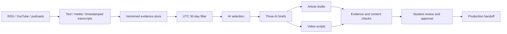

# Problem Set 4 Student Submission

**Status: incomplete; drafts approved and production package prepared.** No article or video has been published. See [current status](docs/STATUS.md) and [final audit](docs/FINAL_AUDIT.md).

**Student:** Yunji Seo (GitHub: yunji-seo)  
**GitHub repository:** https://github.com/yunji-seo/ps04-agent-engineering-brief (private; upload and reviewer access verification pending)  
**Separate 4–6 minute technical demonstration:** Not recorded; [script and shot list](docs/TECHNICAL_DEMO.md)

## Topic and audience

**Agent Engineering Brief** examines practical adoption and verification of AI coding agents for student developers and small software teams with basic programming and Git knowledge.

Its recurring question is: **Which recent advances are useful enough to adopt, and what should developers still verify themselves?** Coverage includes coding workflows, infrastructure, verification, maintainability, permissions and evidence of benefit. It excludes unrelated AI news, unsupported rankings and investment advice. Readers return for specific experiments, evaluation questions and unresolved limitations rather than a list of announcements.

## Series

All three pairs use evidence from the actual October 16, 2026 run. The student approved these drafts for production; they are not completed publications.

| Piece | Title | Substack | YouTube |
| --- | --- | --- | --- |
| 1 | The Infrastructure Underneath Your Agent: What Providers Are Rebuilding and Why It Matters | Not published | Not produced |
| 2 | Green Lights, Empty Boxes: What the Evidence Actually Shows About AI Agent Verification | Not published | Not produced |
| 3 | A Small-Team Adoption Plan: Verify One Task, Budget the Controls, Watch the Roadmap | Not published | Not produced |

[Read all three article/script pairs](runs/2026-10-16T04-24-58-255Z-ee63f048/REVIEW_READY.md). Article lengths are 840, 800 and 808 words excluding references. Narration lengths are 626, 645 and 612 words; estimated duration is 4.47, 4.61 and 4.37 minutes at 140 words/minute. Actual Google Vids/HeyGen production and duration checks remain pending.

## Setup and execution

Tested with Git Bash 5.2.37, Node.js 22.14.0, yt-dlp 2026.08.19, ffmpeg and ffprobe on Windows. From the repository root:

```bash
npm ci
npm test
bash run.sh
```

The complete suite passes **25 tests**. See [setup](docs/SETUP.md) and [verification](docs/TEST_RESULTS.md).

MIT Parley supplies the AI stages at `https://parley.api.mit.edu/v1`, with `claude-sonnet-4-6` pinned in config/ai.json. Supply PARLEY_API_KEY in an ignored private environment file or environment variable. Never submit the key. Existing credits were used; no credits were purchased. Requests retain provider-reported token usage; per-run dollar costs remain unknown.

Topic, sources, policy and four prompt files are configured separately and snapshotted into each run. Source text is untrusted evidence. Exact actual model payloads, including component-added constraints, are retained without credentials under each run's ai directory.

## Architecture



All sixteen required Bash components retain their assigned responsibilities. Component-owned Node helpers handle parsing, storage, editorial contracts and generation. The shared Parley helper provides transport, not orchestration. Only data/store.sh and its owned helper access the persistent evidence index.

See [design and tradeoffs](docs/DESIGN.md). The store uses stable item identities, immutable evidence versions, a single-writer lock and atomic index replacement. This is inspectable and convenient at assignment scale; rewriting a JSON index is inefficient at larger scale.

After actual student approval matching the current review fingerprint:

```bash
bash run.sh --package runs/RUN_ID
```

Replace RUN_ID with the approved run. The packaging component reruns checks and rejects missing or stale approval. The student explicitly approved the current drafts on October 16, 2026; the [production package](runs/2026-10-16T04-24-58-255Z-ee63f048/package/README.md) is prepared. Public publishing authorization is separate. Google Vids/HeyGen production, Substack/YouTube publication and the technical recording are documented [human handoffs](docs/HUMAN_HANDOFFS.md).

## Evidence and actual runs

| Run | Start date | Artifacts | Time and cost |
| --- | --- | --- | --- |
| A: live collection, later editorial recovery | October 15, 2026 UTC and New York | [Summary](runs/2026-10-15T19-13-20-785Z-6ccecf24/summary.json) | About 9h25m start-to-recovery wall time; pauses included; dollars unknown |
| B: live collection, later editorial recovery | October 16, 2026 UTC and New York | [Summary](runs/2026-10-16T04-24-58-255Z-ee63f048/summary.json) | About 18m45s start-to-recovery wall time; dollars unknown |

Both original entry-point attempts failed; downstream recovery is separately recorded. Run A completed recovery on October 16. These are different-day starts with recovery, not two uninterrupted full completions on different dates. Exact assignment-week boundaries remain unconfirmed.

Run B retains 57 eligible items: 53 written, two YouTube and two podcast items, across six publisher identities. It found three new observations, six changed versions and 42 unchanged observations. Five changed versions were layout/sidebar noise rather than new article content. See [actual comparison and limitations](docs/RUN_COMPARISON.md). An earlier [same-day replay](runs/2026-10-15T13-59-38-909Z-90051c10/changes.jsonl) demonstrates 44 unchanged observations.

No live date exclusion occurred in these corpora. Labeled fixtures demonstrate old, future, invalid and missing date exclusions; they are not presented as live evidence.

Current inspection paths:

- [Normalized eligible evidence](runs/2026-10-16T04-24-58-255Z-ee63f048/eligible.jsonl)
- [Actual editorial decisions](runs/2026-10-16T04-24-58-255Z-ee63f048/decisions.jsonl)
- [Three briefs and evidence locators](runs/2026-10-16T04-24-58-255Z-ee63f048/briefs.jsonl)
- [Claim passages and timestamps](runs/2026-10-16T04-24-58-255Z-ee63f048/CLAIM_REVIEW.md)
- [Automated assessment](runs/2026-10-16T04-24-58-255Z-ee63f048/review.json)
- [One complete Deno claim trace](docs/CLAIM_TRACE.md)

Versioned text and segments are in data/assets. The index is accessed through data/store.sh. Original media is retained locally under ignored data/media; [setup instructions](docs/SETUP.md) explain retrieval from saved URLs and transcript limitations. The collected Korean automatic GitHub transcript is not cited in the final drafts.

## Editorial review and revision

The [actual student review](docs/STUDENT_EDITORIAL_REVIEW.md) covers three accepted and three rejected/deferred items. The student agreed with five decisions and changed Deno Is Joining Cloudflare from defer to accept because potential infrastructure implications matter while plans must remain distinct from verified capabilities.

Compare [policy v1](runs/2026-10-15T14-59-33-161Z-664468fb/config/editorial_policy.md) with [policy v2](config/editorial_policy.md). A [controlled replay](docs/POLICY_COMPARISON.md) used the same 44 retained items and changed nine decisions. It also introduced overbroad acceptances; [interpretation notes](docs/POLICY_INTERPRETATION.md) record those disagreements instead of declaring automatic improvement.

[Assistant corrections](runs/2026-10-16T04-24-58-255Z-ee63f048/editorial-corrections.json) and [wording edits](runs/2026-10-16T04-24-58-255Z-ee63f048/final-polish-audit.json) preserve source-checking changes. They are not attributed to the student. Final student content approval for production was supplied on October 16, 2026 and recorded against the unchanged review fingerprint.

## Personal reflection

**Not yet supplied by the student.** Use the [reflection worksheet](docs/REFLECTION_WORKSHEET.md) to discuss one insight, one editorial failure or limitation, an architectural tradeoff and the next improvement. No personal reflection has been fabricated.

Before submission, finish [the audit](docs/FINAL_AUDIT.md), provide the actual publication and demonstration URLs, supply student identity, and verify repository and publication access.
