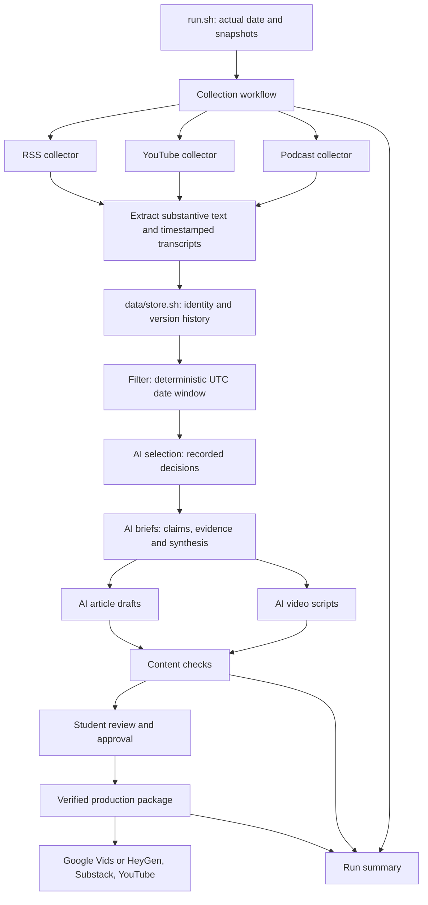

# Design and learning guide

Status: all sixteen components are implemented. Live runs reached drafts and content checks through recorded recovery. Production packaging has passed fixture tests and produced the real approved package after student approval on October 16.

## Technology decisions

Use Bash entry points and workflow orchestration, with a separate Node.js helper owned by each substantive component. Node.js 22.14.0 is already available; a standalone Python installation was not found by the Windows launcher. This avoids a new language-runtime install. Helpers may share parsing, receipts and validation utilities, but not a central pipeline implementation.

Use a documented JSON evidence index behind the store interface initially. It makes versions inspectable and needs no database dependency. The tradeoff is that rewriting the index is inefficient for large collections; single-writer locking and atomic replacement are needed. This assignment has a small corpus and serialized ingestion, so a database is optional.

Use MIT Parley for AI stages, as requested. Official documentation and a live check verified the endpoint, authenticated model listing and bounded generation with `claude-sonnet-4-6`. Credentials remain in an ignored local environment file. A shared transport helper archives payloads without headers; editorial and writing components retain their own responsibility boundaries.

No credit purchase is authorized. API credits are distinct from chat access; positive credit was verified in the API portal before testing. Requests consume this existing credit. Record provider token usage and unknown dollar cost honestly; inspect current balance before substantial new runs.

## Concepts to explain

- An item ID identifies a logical source across executions; a version ID identifies a particular substantive state.
- Date eligibility is a mechanical rule. Audience relevance and evidential strength require editorial judgment.
- A repeated announcement is not independent confirmation. A podcast and its YouTube copy are one underlying item.
- A passing automated content check does not prove the argument is sound. The student reviews interpretation and authorizes publication.
- A package is a handoff to production, not a rendered video or a published article.
- A failed collector must be visible even if the rest of the pipeline can proceed.
- A content hash detects changes in extracted text, not necessarily new information. Five live changed versions contained only sidebar/recommendation updates. The improved extractor narrows article boundaries and labels parser migrations; old evidence is preserved.
- Exact evidence locators and schema checks limit mechanical failures, but cannot prove semantic entailment. Assistant source checks and student editorial review remain distinct from automated assessment.

## Environment inspection

- Git 2.47.1.windows.2; starter downloaded successfully.
- Git Bash 5.2.37 works outside the current Windows sandbox restriction.
- Node.js 22.14.0 is available.
- yt-dlp 2026.08.19 and ffmpeg N-126374 are available.
- These environment versions alone do not prove live processing; the saved run receipts and AI request/response artifacts provide that evidence.

## References

- [MIT Parley API announcement](https://orgchart.mit.edu/letters/parley-api-now-available-mit-community)
- [MIT API knowledge base; login required](https://mit.service-now.com/esc?id=kb_article&sysparm_article=KB0034692)
